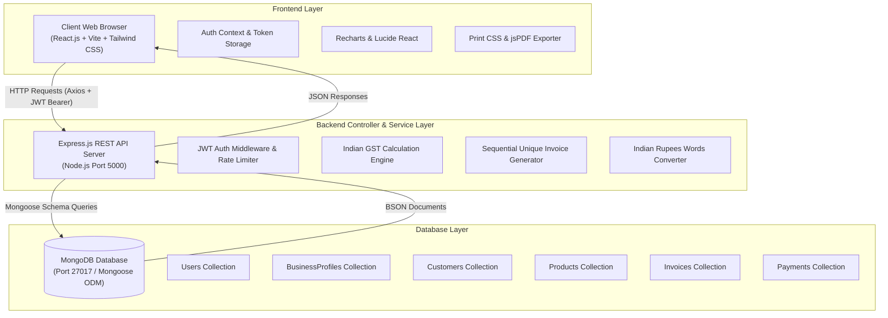
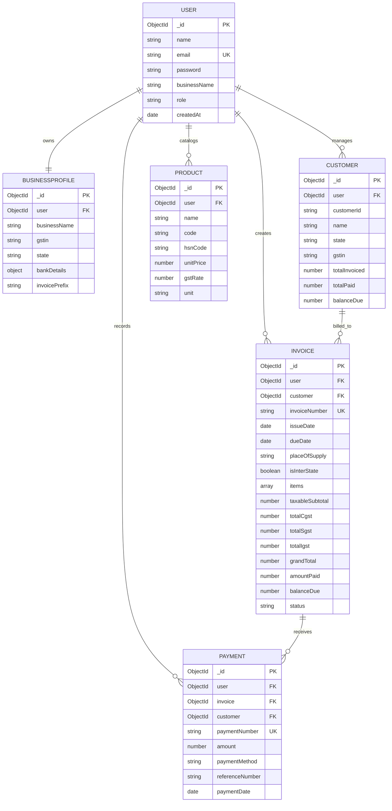

# Billing and Invoice Management System (IBMS)

A Full-Stack Financial Web Application featuring Indian GST Tax Engine, Customer & Product Catalog Management, Real-Time Payment Tracking, Printable Tax Invoices, and Analytical Reporting.

---

## 1. Project Overview & Abstract

The **Billing and Invoice Management System (IBMS)** is an enterprise-grade full-stack web application designed to automate the entire invoicing and payment workflow for small, medium, and growing enterprises in India. The system provides end-to-end features including user registration with multi-tenant data isolation, customer profile directory with GSTIN verification, product/service inventory catalog, dynamic Indian GST calculations (supporting both Intra-State supply with CGST/SGST and Inter-State supply with IGST), multi-line invoice generator, partial and full payment recording, printable A4 tax invoices with client-side PDF export, and comprehensive financial reports with CSV export.

---

## 2. Problem Statement & Objectives

### Problem Statement
Traditional billing processes in small and medium business environments often rely on error-prone paper registers, disconnected spreadsheets, or non-compliant desktop software. Key challenges include:
- Manual calculation errors in multi-rate Indian Goods and Services Tax (GST: 0%, 5%, 12%, 18%, 28%).
- Difficulty determining Intra-State (CGST + SGST) vs Inter-State (IGST) tax rules based on place of supply.
- Disconnected payment records leading to unrecognized overdue accounts and overpayment discrepancies.
- Inability to export real-time ledger summaries and CSV turnover schedules for tax accountants.

### Key Objectives
1. **Automate Tax Calculations**: Eliminate calculation errors through a server-side verified Indian GST engine.
2. **Prevent Overpayments & Discrepancies**: Enforce strict backend validation ensuring payments cannot exceed the outstanding balance.
3. **Data Integrity & Historical Snapshots**: Store immutable customer and product snapshots within each invoice so subsequent price or address edits do not mutate historical records.
4. **Professional Invoice Delivery**: Produce compliant, print-ready Indian Tax Invoices featuring company GSTIN, HSN/SAC codes, and numbers converted to Indian Rupees in words.
5. **Real-Time Financial Intelligence**: Distinguish cash collected revenue from total invoiced sales on live dashboards and analytical charts.

---

## 3. Existing System vs. Proposed System

| Feature | Existing Manual / Spreadsheet System | Proposed IBMS Web Platform |
| :--- | :--- | :--- |
| **Tax Determination** | Manual calculation prone to confusion between CGST/SGST and IGST | Automated state-comparison engine determining CGST/SGST vs IGST |
| **Security & Isolation** | Unprotected spreadsheets accessible to unauthorized persons | Secure JWT authentication with strict per-user database scoping |
| **Overpayment Handling** | Untracked manual payments often leading to account mismatches | Enforced validation rejecting zero, negative, or overpayments |
| **Invoice Formatting** | Inconsistent templates lacking HSN/SAC and amount in words | Standard Indian Tax Invoice template with A4 media print styling and PDF export |
| **Historical Invoices** | Price changes in inventory alter historical spreadsheet records | Historical snapshots stored inside invoices preserving financial audit integrity |
| **Analytics & Export** | Tedious manual formula compilation | Real-time Recharts dashboards and 1-click CSV exports |

---

## 4. System Architecture



---

## 5. Technology Stack

### Frontend
- **Framework**: React.js (v19) with Vite
- **Routing**: React Router DOM (v7)
- **Styling**: Tailwind CSS with custom responsive layout and `@media print` rules
- **Icons**: Lucide React
- **Data Visualization**: Recharts (Monthly Trends & Status Mix)
- **HTTP Client**: Axios with centralized request/response interceptors
- **PDF Generation**: `jspdf` and `html2canvas`

### Backend
- **Runtime**: Node.js (v24 LTS compatible)
- **Framework**: Express.js
- **Database**: MongoDB (v8) via Mongoose ODM
- **Authentication**: JSON Web Tokens (JWT) & `bcryptjs` password hashing
- **Security & Protection**: `cors`, `express-rate-limit`, `dotenv`
- **Logging**: Morgan HTTP logger

---

## 6. Database Design & Entity Relationships



---

## 7. Folder Structure

```
IBMS/
├── backend/
│   ├── config/
│   │   └── db.js                        # MongoDB Mongoose connection
│   ├── controllers/
│   │   ├── authController.js            # Registration, Login, Session
│   │   ├── businessProfileController.js # Company & Bank settings
│   │   ├── customerController.js        # Customer directory & balances
│   │   ├── productController.js         # Products & services catalog
│   │   ├── invoiceController.js         # GST engine & invoice management
│   │   ├── paymentController.js         # Collections & reconciliation
│   │   ├── dashboardController.js       # Live metrics & trends
│   │   └── reportController.js          # Revenue, GST & sales reports
│   ├── middleware/
│   │   ├── auth.js                      # JWT verification middleware
│   │   └── errorMiddleware.js           # Mongoose & HTTP error handler
│   ├── models/
│   │   ├── User.js                      # User model with bcrypt
│   │   ├── BusinessProfile.js           # Business profile model
│   │   ├── Customer.js                  # Customer model
│   │   ├── Product.js                   # Product model
│   │   ├── Invoice.js                   # Invoice snapshot model
│   │   └── Payment.js                   # Payment record model
│   ├── routes/
│   │   ├── authRoutes.js
│   │   ├── businessProfileRoutes.js
│   │   ├── customerRoutes.js
│   │   ├── productRoutes.js
│   │   ├── invoiceRoutes.js
│   │   ├── paymentRoutes.js
│   │   ├── dashboardRoutes.js
│   │   └── reportRoutes.js
│   ├── utils/
│   │   ├── gstCalculator.js             # Intra/Inter state GST logic
│   │   ├── invoiceNumberGenerator.js    # Concurrent-safe sequential generator
│   │   ├── numberToWords.js             # Indian Rupees word converter
│   │   └── seedData.js                  # Realistic demo data seeder
│   ├── tests/
│   │   └── api.test.js                  # Automated REST API test suite
│   ├── server.js                        # Express server entrypoint
│   ├── package.json
│   ├── .env
│   └── .env.example
├── frontend/
│   ├── public/
│   ├── src/
│   │   ├── components/
│   │   │   ├── common/                  # Navbar, Sidebar, Badges, Modals
│   │   │   └── invoices/                # Printable template, Payment modal
│   │   ├── context/
│   │   │   └── AuthContext.jsx          # React Auth Context & Session
│   │   ├── layouts/
│   │   │   ├── AppLayout.jsx            # Protected workspace shell
│   │   │   └── AuthLayout.jsx           # Branded login/register shell
│   │   ├── pages/
│   │   │   ├── auth/                    # Login and Register
│   │   │   ├── dashboard/               # Financial Dashboard
│   │   │   ├── customers/               # Customer Directory & Profile
│   │   │   ├── products/                # Catalog Management
│   │   │   ├── invoices/                # Creator, List, Details, Editor
│   │   │   ├── payments/                # Collections Ledger
│   │   │   ├── reports/                 # 6-Tab Analytics & CSV Exporter
│   │   │   └── settings/                # Company Profile & GST settings
│   │   ├── services/
│   │   │   └── api.js                   # Central Axios configuration
│   │   ├── utils/
│   │   │   ├── formatters.js            # Currency & date formatting
│   │   │   └── exportCsv.js             # Client CSV export utility
│   │   ├── App.jsx                      # React Router tree
│   │   ├── main.jsx                     # Vite root entrypoint
│   │   └── index.css                    # Tailwind + @media print styles
│   ├── index.html
│   ├── tailwind.config.js
│   ├── postcss.config.js
│   ├── package.json
│   ├── .env
│   └── .env.example
├── package.json                         # Root helper scripts
└── README.md
```

---

## 8. REST API Documentation

All protected endpoints require an `Authorization: Bearer <token>` header.

### Authentication
- `POST /api/auth/register` — Create account and auto-provision business profile
- `POST /api/auth/login` — Authenticate and receive JWT token
- `GET /api/auth/me` — Retrieve active session profile
- `POST /api/auth/logout` — Invalidate user session

### Customers
- `GET /api/customers` — Query customers (supports `search`, `state`, `sort`, `page`, `limit`)
- `POST /api/customers` — Add a new customer
- `GET /api/customers/:id` — Customer profile, ledger, and historical invoices
- `PUT /api/customers/:id` — Update customer details
- `DELETE /api/customers/:id` — Safely delete customer (rejected if invoices exist)

### Products & Services
- `GET /api/products` — Query catalog (supports `search`, `type`, `category`, `sort`, `page`)
- `POST /api/products` — Add product/service with GST rate (0, 5, 12, 18, 28%)
- `GET /api/products/:id` — Get product details
- `PUT /api/products/:id` — Update catalog item
- `DELETE /api/products/:id` — Safe delete (rejected if referenced in invoices)

### Invoices
- `GET /api/invoices` — Query invoices (supports `status`, `startDate`, `endDate`, `search`)
- `POST /api/invoices` — Create and calculate GST invoice (Draft or Issued)
- `POST /api/invoices/calculate` — Dry-run server calculation preview
- `GET /api/invoices/:id` — Get full invoice details with payments and words conversion
- `PUT /api/invoices/:id` — Edit draft or eligible unpaid invoice
- `POST /api/invoices/:id/void` — Void invoice with audit trail reason
- `DELETE /api/invoices/:id` — Delete draft/voided invoice with 0 payments
- `GET /api/invoices/:id/payments` — Get payments linked to this invoice

### Payments
- `GET /api/payments` — Get payments ledger with method and date filtering
- `POST /api/payments` — Record partial or full payment (enforces overpayment prevention)
- `GET /api/payments/:id` — Get payment receipt
- `DELETE /api/payments/:id` — Revert payment receipt and recalculate invoice balance

### Dashboard & Reports
- `GET /api/dashboard/stats` — Real-time KPIs (Total invoiced, cash collected, outstanding due)
- `GET /api/dashboard/revenue` — 6-month trend and invoice status distribution
- `GET /api/reports/revenue` — Daily/monthly invoiced vs collected revenue
- `GET /api/reports/invoices` — Comprehensive invoice turnover breakdown
- `GET /api/reports/payments` — Payment ledger and payment method breakdown
- `GET /api/reports/gst` — Intra/Inter state breakdown and rate-wise tax schedule
- `GET /api/reports/customers` — Customer sales ledger summary
- `GET /api/reports/products` — Product sales and quantity breakdown

### Business Profile
- `GET /api/business-profile` — Fetch business details, GSTIN, and bank account
- `PUT /api/business-profile` — Update company settings

---

## 9. Installation & Startup Instructions (Windows PowerShell)

### Prerequisites
1. **Node.js** (v18.0 or newer)
2. **MongoDB** (running on `mongodb://127.0.0.1:27017`)

### Step 1: Clone or Navigate to the Workspace
```powershell
cd c:\Users\Gomathi\OneDrive\Desktop\IBMS
```

### Step 2: Seed Realistic Demo Data
Run the database seeder to populate sample customers, products, and multi-state GST invoices:
```powershell
npm run seed
```
*(Seeder output will confirm creation of demo user: `demo@example.com` with password `Password123!`)*

### Step 3: Run Backend Test Suite
Verify that all 11 REST API endpoints and GST calculations pass:
```powershell
npm test
```

### Step 4: Start the Application

**Terminal 1 — Start Backend Server:**
```powershell
cd c:\Users\Gomathi\OneDrive\Desktop\IBMS\backend
npm start
```
*Backend runs on: `http://localhost:5000`*

**Terminal 2 — Start Frontend Application:**
```powershell
cd c:\Users\Gomathi\OneDrive\Desktop\IBMS\frontend
npm run dev
```
*Frontend runs on: `http://localhost:5173`*

Open your web browser and navigate to: **`http://localhost:5173`**

---

## 10. Sample Demonstration Workflow for College Review

1. **Sign In**:
   - Navigate to `http://localhost:5173/login`.
   - Click the **"Quick Demo: Load College Project Credentials"** button (or enter `demo@example.com` / `Password123!`).
   - Click **"Sign In to Workspace"**.

2. **Dashboard Review**:
   - Review the live KPI cards: Total Invoiced, Collected Revenue, Outstanding Due, and Overdue Count.
   - Inspect the **Monthly Invoiced vs Collected** chart (Recharts) and the **Invoice Status Mix** donut chart.

3. **Customer & Catalog Directory**:
   - Click **Customers** in the sidebar. Notice customers from Maharashtra (intra-state) and Karnataka / Telangana (inter-state).
   - Click **Products & Services** to view HSN codes, GST rates (0%, 18%), and unit prices.

4. **Create a New GST Invoice**:
   - Click **Create Invoice** in the top navigation bar.
   - Select customer **TechNova Solutions LLP** (Maharashtra). Notice the badge indicates: **Intra-State Supply (CGST 9% + SGST 9%)**.
   - Change customer to **Global Logistics Infotech Ltd** (Karnataka). Notice the badge dynamically updates to: **Inter-State Supply (IGST 18%)**.
   - Add line items, edit quantities, and observe live calculation of taxable value, tax split, and Indian Rupees in words.
   - Click **Issue & Finalize Invoice**.

5. **Print & PDF Export**:
   - On the invoice details page, inspect the Tax Invoice layout.
   - Click **Print** to test the clean `@media print` format without sidebars.
   - Click **Download PDF** to generate an instant client-side PDF document.

6. **Record Payment & Overpayment Prevention**:
   - Click **Record Payment**.
   - Enter an amount higher than the remaining balance to demonstrate the **Overpayment Prevention Validation**.
   - Enter a valid partial payment (e.g. ₹5,000) via UPI or Bank Transfer.
   - Observe the invoice status instantly update to **Partially Paid** and the balance due adjust.

7. **Reports & CSV Export**:
   - Navigate to **Reports & Analytics**.
   - Click through **Revenue & Cash**, **GST Tax Compliance**, and **Customer Sales**.
   - Click **Export to CSV** to download a spreadsheet report.

---

## 11. Known Limitations & Future Enhancements

- **Email Service**: External SMTP delivery (e.g., SendGrid/Nodemailer) can be connected for emailing PDFs directly to customers.
- **Payment Gateway**: Current version records offline payments (UPI, NEFT, RTGS, Cash); future iterations can integrate Razorpay/Stripe webhooks for online checkout.
- **E-Way Bill & E-Invoicing**: Future updates can integrate government NIC portal APIs for businesses with turnover exceeding ₹5 Crore.
# BIMS-FSD-report

